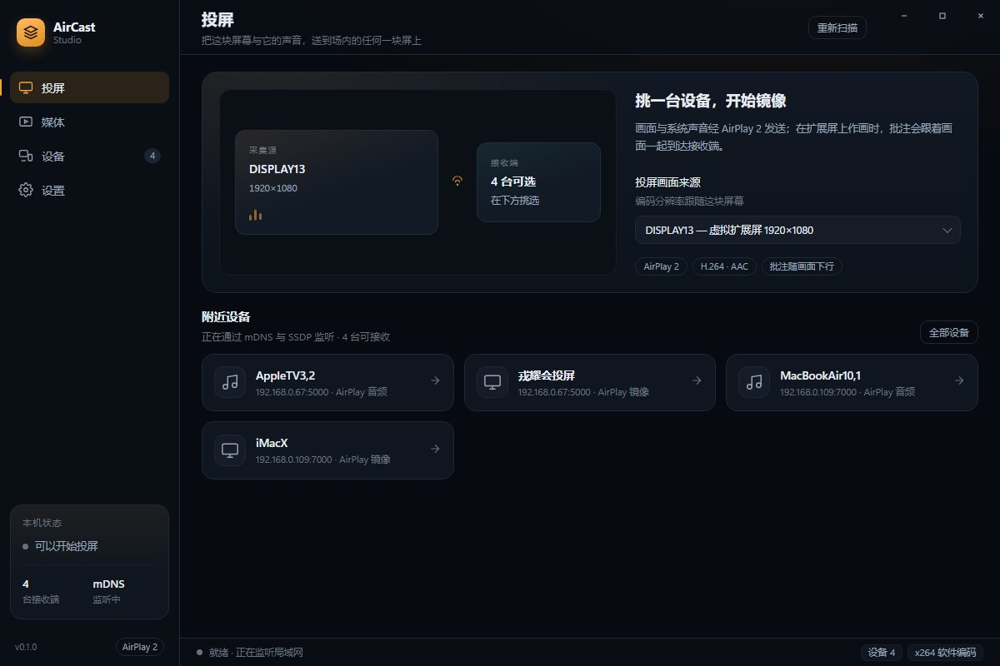
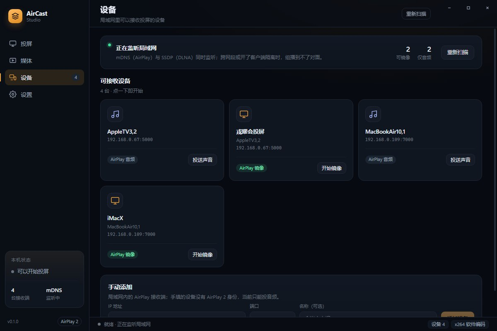
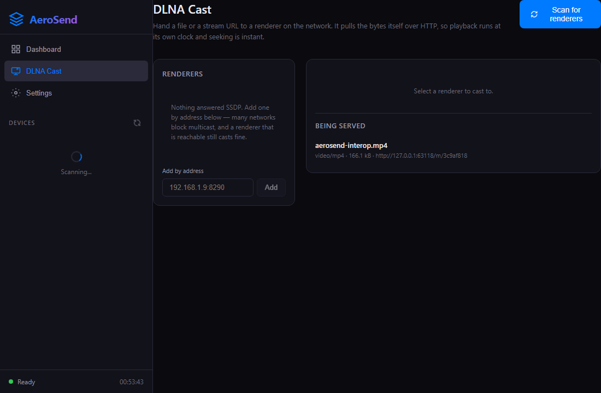
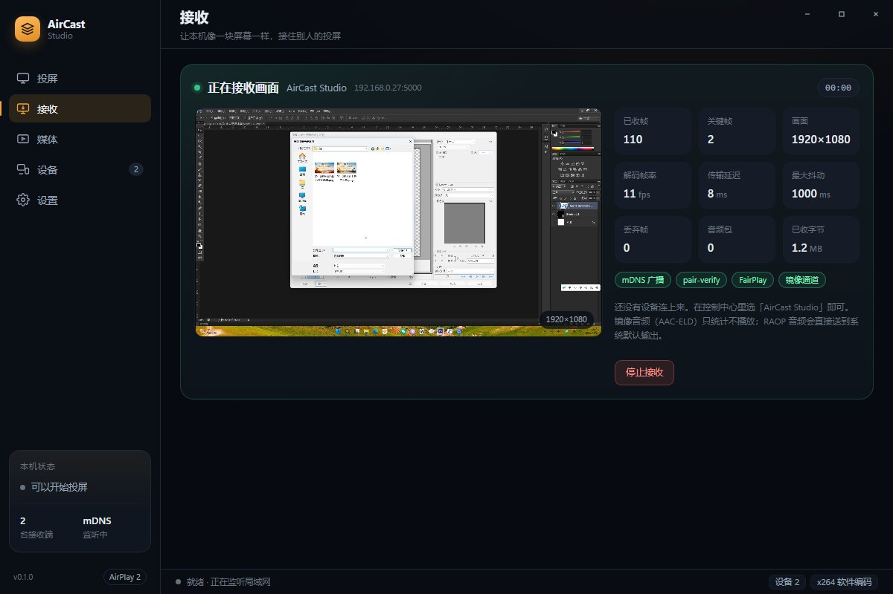
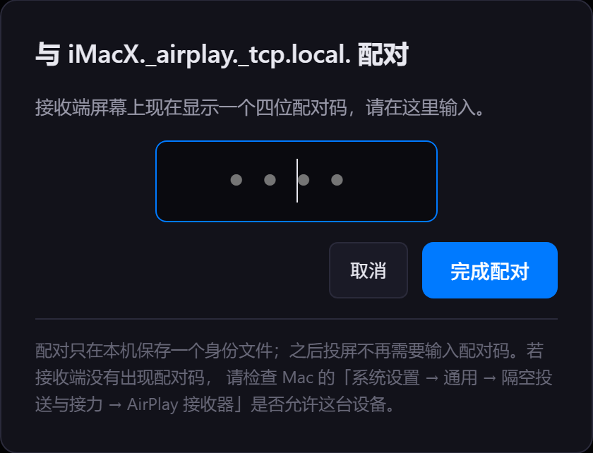
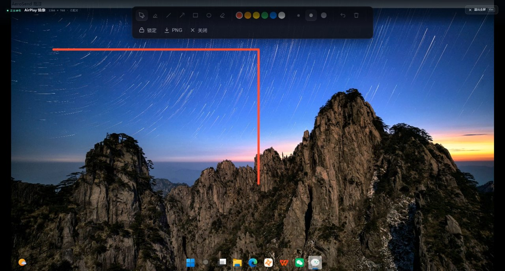
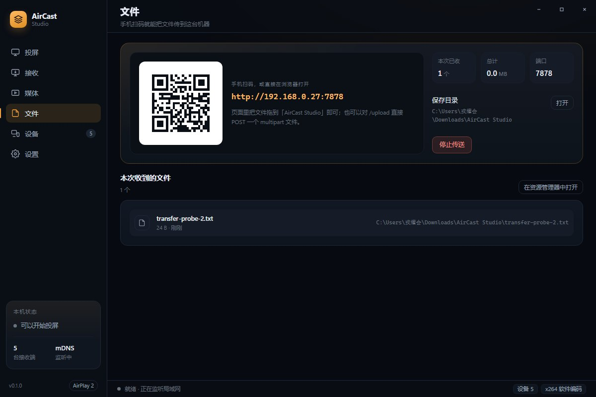
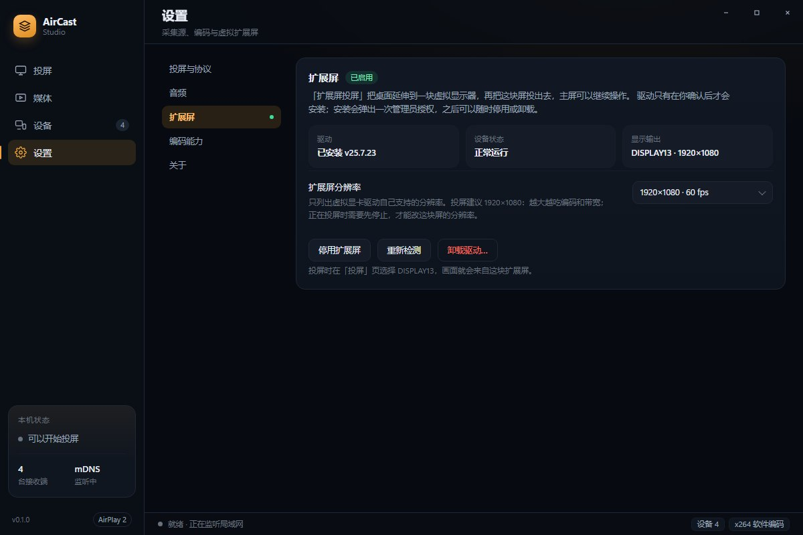

# AirCast Studio

<p>
  
  
  
  
</p>

> 一台 Windows 电脑同时做**投屏发送端**和**投屏接收端**：把屏幕推给 AirPlay / DLNA 设备，也接收 AirPlay 镜像、浏览器画面和 DLNA 投放，并自带批注与局域网文件传送。
>
> A professional AirPlay / DLNA **sender *and* receiver** for Windows — screen mirroring, media casting, in-session annotation and LAN file transfer, with no server, no account and nothing leaving your network.

产品前身为 AeroSend，现更名为 **AirCast Studio**。协议层的稳定标识（SDP 会话名、`Server: AeroSend/1.0`、防火墙规则名、包名 `aerosend`）刻意保持不变，避免同一台机器上出现两套身份或重复的防火墙规则。

截至 1.1.1，实现源码与逐轮验证记录发布在 [thinkbugs/AeroSend](https://github.com/thinkbugs/AeroSend)（本产品更名前的仓库）；本页面承载产品介绍与文档。

---

## 亮点

| | |
| --- | --- |
| **双向** | 既是 AirPlay 2 / AirPlay 1 / RAOP 发送端，也是 AirPlay 接收端、DLNA DMR 渲染器、浏览器投屏落地端——一台机器能投出去，也能收进来。 |
| **纯局域网** | 全部链路在本地网络内完成：mDNS / SSDP 发现，RTSP / SOAP / WebSocket 传输，内置 HTTP 媒体服务器供流。无云端、无账号、无第三方 SDK。 |
| **自己实现协议** | 采集（DXGI Desktop Duplication）→ 编码（x264 / NVENC / QSV）→ 加密（AES-128-CTR、ChaCha20-Poly1305）→ 分帧发送，全部在 Rust 侧；前端只通过 83 个 Tauri 命令访问协议层。 |
| **画面 + 声音 + 批注** | 镜像会话内可带音频（AirPlay 2 走 ALAC、AirPlay 1 走 AAC-LC、RAOP 走 L16），批注层是独立的全屏透明置顶窗口，墨迹随屏幕一起编码送出，不加第二条链路。 |
| **收端也能上扩展屏** | 接收画面可放到指定显示器（全屏无边框置顶），DLNA 视频用独立的原生播放窗口，跟随所选显示器。 |
| **文件传送** | SnapDrop 兼容的传送页与 `POST /upload`：手机扫码即传，两台装了本产品的电脑通过 mDNS 互认后可直接互发文件。 |

## 界面

| 投屏（发送端） | 设备发现 |
| --- | --- |
|  |  |

| 媒体投屏（DLNA） | 接收（本机作为接收端） |
| --- | --- |
|  |  |

| AirPlay 配对码 | 批注层 |
| --- | --- |
|  |  |

| 文件传送 | 设置 · 扩展屏 |
| --- | --- |
|  |  |

界面文案为中文；协议与采集的深层错误（RTSP 状态码、DXGI / ffmpeg 报错）保留英文原文，便于和日志与上游文档对照。

## 能力

| 模块 | 说明 |
| --- | --- |
| 设备发现 | mDNS `_airplay._tcp` / `_raop._tcp`（发送端）、SSDP（DLNA）。扫描不到时可手填 `ip` 或 `ip:port`。 |
| 屏幕镜像 | AirPlay 2：pair-setup / pair-verify（Ed25519 + HAP）→ FairPlay → `SETUP`（plist）→ AES-128-CTR 视频流。采集为 DXGI Desktop Duplication，编码 x264（zerolatency）/ NVENC / QSV，`Auto` 选择**真正能打开**的编码器。 |
| 镜像音频 | 同一会话内的 stream 96，按握手实际协商结果分派两种方言：AirPlay 2（macOS / AppleTV 系）= WASAPI loopback → ALAC verbatim（352 采样/包）→ ChaCha20-Poly1305，含周期 announce 与 `0xd5 → 0xd6` 重传应答；AirPlay 1（UxPlay 系）= AAC-LC（1024 采样/包）→ RTP + AES-128-CBC，control 口每 3 s 做 RTP↔NTP 同步。 |
| 系统音频 | RAOP 扬声器通道：WASAPI loopback → s16be → L16（PT 96，44.1 kHz 立体声，明文，352 帧/包），带 RTCP SR 与 `SETUP` 要求的 control / timing 端口。 |
| 媒体投屏（DLNA / UPnP AV） | 视频、图片、音乐三类都能投：SSDP 找渲染器 → SOAP 控制（DIDL 按类型给出 `videoItem` / `imageItem.photo` / `audioItem.musicTrack`）+ 内置 HTTP 媒体服务器（Range / 206 / 416 / HEAD），地址自带扩展名，只看 URL 认类型的接收端也能工作；播放进度、时长、音量都从设备读回，界面不自造时钟。 |
| AirPlay 接收 | 本机作为接收端：mDNS 广播、RTSP、pair-verify、FairPlay、镜像 TCP；H.264 交给 WebCodecs 解码，RAOP 音频直接出声。 |
| DLNA 渲染器接收 | 内置 DMR：SSDP 应答 + 设备描述 + AVTransport / RenderingControl SOAP；投放的视频在独立原生播放窗口解码，可跟随所选显示器，双击隐藏。 |
| 浏览器投屏接收 | 固定端口 `ws://<host>:9407/stream` 的 RFC 6455 通道，接收浏览器侧 WebCodecs 编码后的 H.264 access unit，自动开接收墙并解码显示。 |
| 批注 / 标注 | 独立全屏透明置顶窗口（第二个 webview 文档），7 工具 × 6 色 × 3 笔宽 + 撤销 / 清空；Lock 走 `WS_EX_TRANSPARENT` 鼠标穿透；导出 PNG 走 Windows 原生保存框。 |
| 扩展屏投屏（虚拟显示器） | 把桌面延伸到一块虚拟显示器，只投这块屏，主屏可以继续操作；驱动由设置页校验 SHA-256 后安装，可启停与改分辨率。 |
| 局域网文件传送 | SnapDrop 兼容页面与 `POST /upload`；二维码扫码即用，手机文件中继到本机；两台本产品的电脑通过 mDNS `_aircast._tcp` 互发现、互发文件；保存目录、设备名与端口可配。 |
| 托盘与设置 | 双击托盘恢复窗口；`settings.json` 写入-改名原子落盘；「关于」页支持检查更新。 |

## 网络与端口

第一次运行请在 Windows 防火墙里放行专用网络（应用会自动引导，规则名仍是 `AeroSend`）。

| 用途 | 传输 / 端口 |
| --- | --- |
| 设备发现（发送端） | mDNS UDP 5353（`_airplay._tcp` / `_raop._tcp`）、SSDP UDP 1900 |
| AirPlay 控制 | RTSP TCP 5000 |
| AirPlay 媒体 | `SETUP` 协商的临时端口（UDP / TCP） |
| DLNA 媒体供流（发送端） | 内置 HTTP 服务器，临时端口，地址形如 `/m/{id}.{ext}` |
| AirPlay 接收 | RTSP TCP 5000（被占用时回退临时端口） |
| DLNA 渲染器接收 | TCP 8290（设备描述与 SOAP 控制） |
| 浏览器投屏接收 | TCP 9407（WebSocket `/stream`） |
| 局域网文件传送 | TCP 7878（SnapDrop 页面 / `POST /upload` / WS 中继）、mDNS `_aircast._tcp` |

## 工作原理

**AirPlay 2 镜像**

```
DXGI duplication ──► encoder (x264 zerolatency / NVENC / QSV) ──► access units ──► AVCC ──► 密封 ──► TCP 数据口
WASAPI loopback  ──► ffmpeg 重采样/下混 ──► 音频帧 ──► 密封 ──► UDP 数据口（+ control 口 announce / 重传应答）
                                                                                          │
RTSP  GET /info → pair-setup → pair-verify → fp-setup ×2 → SETUP(stream 96 + 110) → RECORD ┘
```

编码输出队列上限 `MAX_BACKLOG_FRAMES = 6`——超帧丢弃，而不是堆积延迟。

**DLNA 媒体投屏**

```
SSDP M-SEARCH ─► 渲染器 ─► GET 设备描述 ─► 解析 3 个 service control URL
                                              │
本地文件 ─► 内置 HTTP 媒体服务器(206/Range/416/HEAD) ◄── SetAVTransportURI(DIDL) ─► AVTransport
URL 直投 ─► 不经本地服务器                                              Play/Pause/Stop/Seek(REL_TIME)
```

渲染器是**拉**的一方，所以媒体服务器的 Range 分段与 `Content-Range` 必须正确——这是绝大多数「投出去只有声音没画面」问题的真实位置。

**接收端（三条腿）**

```
AirPlay 发送端 ──mDNS──► RTSP :5000 ──► pair-verify / FairPlay ──► H.264 ──► WebCodecs 解码 ──► 接收墙
浏览器扩展    ──ws────► :9407/stream ─► Annex-B access unit ─────┘
DLNA 控制点   ──SSDP──► DMR :8290 ──► SetAVTransportURI + Play ──► 原生播放窗口（IMFMediaEngine）
```

三条腿各自拥有独立的解码器与独立的状态计数，互不抢占，接收页把三个开关并排放在一起。

## 系统要求

- Windows 10 / 11，x64。
- 支持 DXGI Desktop Duplication 的显卡（用于采集）。
- 编码器可选 NVIDIA NVENC / Intel QSV；两者都不可用时自动回退到随包的 x264（zerolatency）。ffmpeg 随安装一起分发，无需单独安装。
- 与接收设备处于同一局域网；镜像与文件发现依赖组播（mDNS / SSDP），受限网络请用手填地址入口。

## 安装与快速上手

1. 安装 `AirCast Studio_x64-setup.exe`（NSIS）或 `.msi`，装到当前用户的 `%LOCALAPPDATA%\AirCast Studio`。
2. 首次启动时在防火墙弹窗里勾选**专用网络**。
3. **投屏**页选择采集源 → 设备列表里点目标（搜不到就用「手动添加」填 `ip` 或 `ip:port`）→ 开始投屏。接收端要求配对时会弹出 4 位配对码，在对方设备上输入即可（凭据持久化，之后免输）。
4. **媒体**页投视频 / 图片 / 音乐给 DLNA 渲染器；**接收**页可把本机变成 AirPlay / DLNA / 浏览器投屏的落地端，并用「放到扩展屏」把画面送到指定显示器。
5. **文件**页开启传送后扫码即可从手机上传；两台装了本产品的电脑会互相出现在对方列表里，可直接互发文件。
6. 投屏期间用**批注**在画面上书写，墨迹会随屏幕内容一起送达接收端。

## 从源码构建

```bash
npm install
npm run tauri dev            # 开发（vite 已忽略 src-tauri/target，避免 EBUSY）
npm run build                # 前端类型检查 + 打包
npm run tauri build          # 发布安装包（NSIS + MSI）
npx tauri icon design/app-icon.svg -o src-tauri/icons    # 改了图标源就重新生成全套
```

版本号在 `package.json`、`src-tauri/tauri.conf.json`、`src-tauri/Cargo.toml` 三处声明，必须一起改：`tauri.conf.json` 决定安装器的名称与版本，`Cargo.toml` 决定 crate 版本（这也是可执行文件叫 `aerosend.exe` 而安装器带产品名的原因）。

编码器可用性**不是**看 `ffmpeg -encoders` 列没列出来，而是真的喂一帧去打开它——开发机上出现过列了 `h264_nvenc` 却在第一帧报 `Cannot load nvcuda.dll` 的情况，`Auto` 会选真正能打开的那个。

## 测试与验证

```bash
cd src-tauri
cargo test --lib             # 400+ 条 Rust 单测：分帧、加密封包、协商、DIDL、状态机
cargo test                    # 含 src-tauri/tests 下的集成用例

# 真机互操作（需要对端在场，默认 #[ignore]）
AEROSEND_PEER=127.0.0.1:5000 cargo test --test test_interop_airplay -- --ignored --nocapture --test-threads=1
cargo test --test test_interop_hub_dmr -- --ignored --nocapture --test-threads=1
```

AirPlay 互操作需要一个真实接收端在线（RAOP 音频、AirPlay 2 镜像、mDNS 能力广播三条腿）；DLNA 那条需要一个真实渲染器在场，它会真的解码我们供出的字节。音频相关用例自带 `ffplay` 声源——WASAPI loopback 只镜像正在播放的声音，空闲机器上采不到东西。

每一轮的实测（协议根因、耗时、真机结果与未验证项）都以 `docs/TEST-REPORT-*.md` 的形式随源码发布，覆盖 1.0 发布、镜像性能、断流修复、媒体投屏、AirPlay 2 配对、macOS 403、扩展屏批注、镜像音频 AirPlay 2 方言，以及浏览器 / DLNA 接收端集成。

## 已验证的对端与边界

已在真实设备上打通：macOS 原生接收端（iMac，HAP 配码 + 密码门，画面 / 延迟 / 会话结束 / 重投均实测）、安卓 AirReceiver（RTSP `SETUP` 方言）、HORIZON 会议中枢（AirPlay + DLNA），以及协议级 fake 设备的回归用例。**Apple TV 与第三方电视未做验证。**

诚实的边界：

- **AirPlay 1 方言的镜像音频用 AAC-LC，不是 Apple 原厂的 AAC-ELD**：ffmpeg 官方 Windows 构建没有 AAC-ELD 编码器（需要 libfdk_aac）。按协商值（`ct=4`）分派的接收端可以解；Apple 硬件在该流上固定 `ct=8`（AAC-ELD），未在 Apple TV 上验证。AirPlay 2 路径不受影响——它按 `ct=2` 发 ALAC verbatim。
- **AirPlay 1 方言的 UDP 丢包不重传**：那条路径不接 retransmit 请求，A/V 同步只依赖每 3 s 的同步包。AirPlay 2 路径已实现 `0xd5 → 0xd6` 重传应答。
- **AirPlay 2 路径不做方言降级**：若某接收端在 AirPlay 2 会话里只接受 `ct=4`，结果是协商失败后只投画面。
- **RAOP 只承载音频**：不带 `pk` 的设备（或手填地址）只能投音频；`pk`（Ed25519 身份）是能否做 pair-verify 的判断依据。
- **镜像音频是否出声需要人耳确认**：自动化能证明协商成功、按实时节奏投递、对端不拆会话，但「听见」不在这类断言的能力范围内，报告中此类结论均标注为待确认。
- 公司网络屏蔽组播时，mDNS / SSDP 发现会失效，请使用手填地址入口。

## 相关项目

[HORIZON-Meeting-Hub](https://github.com/thinkbugs/HORIZON-Meeting-Hub) 会议白板启动器是本项目最常见的接收端：两者不共享任何代码，只共享协议（AirPlay 镜像、RAOP、DLNA DMR、SnapDrop `POST /upload`），互操作结论逐条记录在随源码发布的验证报告里。

## 许可

GPL-3.0。见 [LICENSE](LICENSE)。
